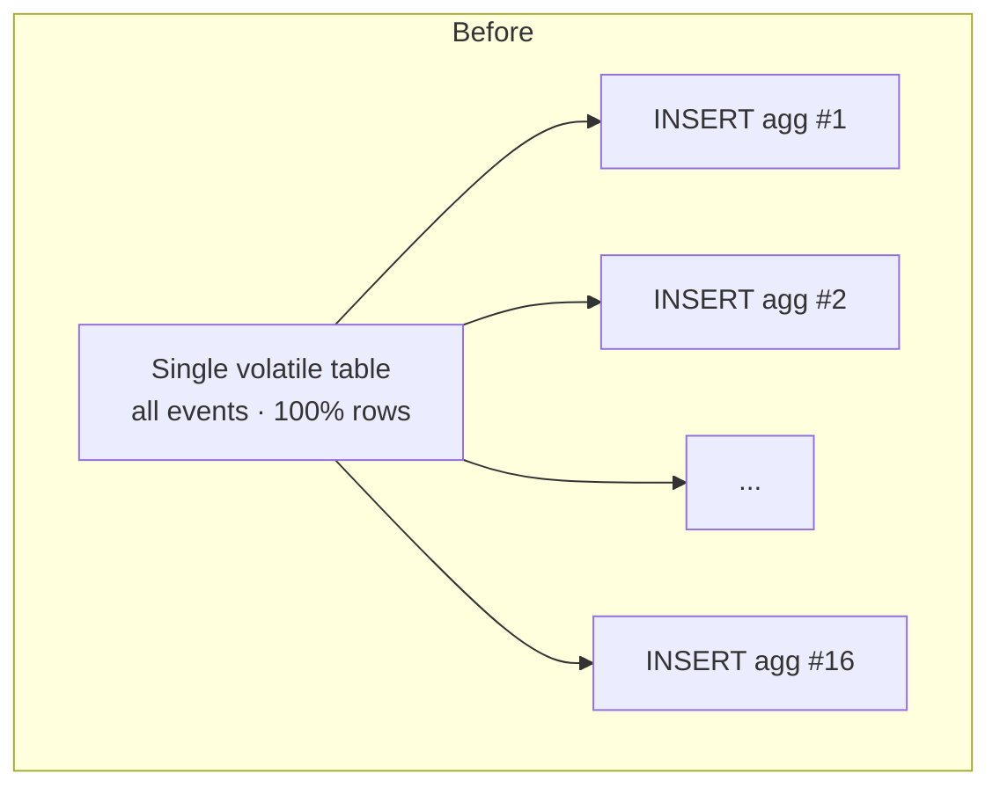
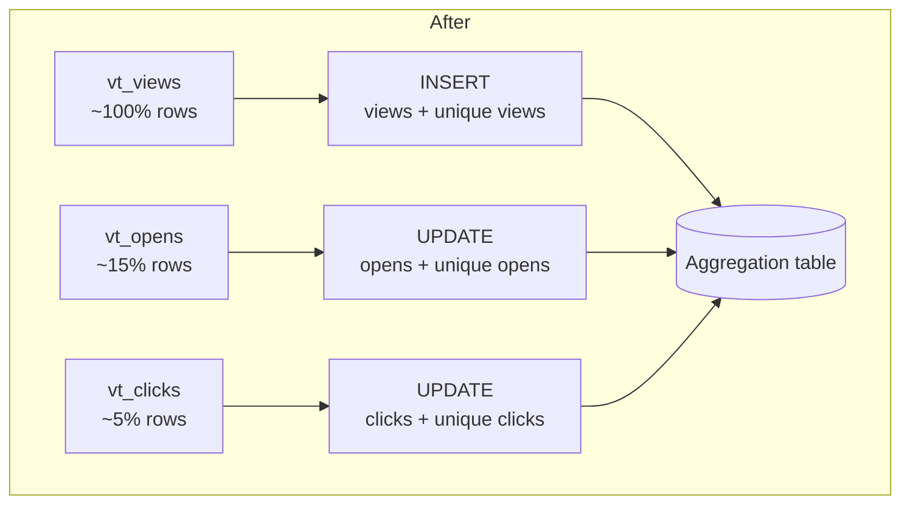

# Campaign Aggregation Optimization

Case study: reworking a weekly Teradata procedure that populates the monetization team's dashboard aggregation tables. Reduced CPU total time and IO operations by ~4x across the full procedure, while preserving the full scope of calculations.

> Part of the [analytics-engineer-portfolio](https://github.com/valentingukalov92/analytics-engineer-portfolio).
> All data and proprietary details have been anonymized.

---

## Problem & Context

### Business context

The procedure populates aggregation tables consumed by the monetization team's dashboard. It runs **weekly**, covering **~10 ad campaigns** at the time of optimization, with expected growth to **several dozen**.

### Pain points

- **Heavy Teradata load**: significant CPU and IO consumption, with support escalations describing the query as "very heavy"
- **Long and unpredictable runtime**: **1 to 5 hours** depending on system load and execution priority
- **Scaling risk**: load grew linearly with campaign count — at 30+ campaigns the situation would have worsened
- **Business risk**: a 5-hour weekly procedure left little margin before the reporting window closed

### Original architecture

A single volatile table with columns `campaign_name`, `device_type_name`, `os_name`, `user_client`, `contact_channel`. For each campaign, **16 INSERT blocks** populated the aggregation table — one per slice combination. The 16 slices are **all non-empty combinations of the 4 dimensions**, where each dimension is either a specific value or `"All"`:

| # | `contact_channel` | `user_client` | `device_type_name` | `os_name` |
|---|---|---|---|---|
| 1 | value | value | value | value |
| 2 | **All** | value | value | value |
| 3 | value | **All** | value | value |
| 4 | value | value | **All** | value |
| 5 | value | value | value | **All** |
| 6 | **All** | **All** | value | value |
| … | … | … | … | … |
| 16 | **All** | **All** | **All** | **All** |

In ANSI SQL this is a `GROUPING SETS` / `CUBE` pattern; in Teradata it was implemented as 16 separate INSERTs.

**Why detail-level data could not simply be pushed to BI:** the aggregated metrics include unique counts (unique impressions, unique opens, unique clicks) that are **non-additive** — the `"All"` slice is not the sum of its sub-slices. Every combination therefore had to be pre-computed. At **350M+ detail rows accumulated over 3 months** (all campaigns combined, trending to 400M+), FineBI would not cope.

**Metrics computed in the procedure** (6 total, 3 event types × total + unique):

- impressions, unique impressions
- opens, unique opens
- clicks, unique clicks

Deliverability and base coverage are calculated **downstream**, after aggregation, and are out of scope for this procedure.

### Objective

Reduce Teradata load as much as possible while preserving the full scope of calculations and business logic.

### Constraints

- **All campaigns, weekly** — volume and frequency could not be reduced (business requirement)
- **Teradata only** — no external tooling allowed
- Target aggregation table schema could not change
- Source schema could not change

### Alternatives considered and rejected

- **Exporting the subscriber list (~45M) and flagging events per subscriber** — rejected: with varying dates the table would balloon just like the original volatile table, without solving the load problem

---

## Diagnostics

### 1. Data distribution

Simple `COUNT(*)` per event type across the three source tables:

| Event type | Share of rows |
|---|---|
| Views (`views_flag > 0`) | ~80% |
| Opens (`opens_flag > 0`) | ~15% |
| Clicks (`clicks_flag > 0`) | ~5% |

**Insight:** 4 of the 6 `COUNT(DISTINCT ...)` operations (unique opens/clicks and their totals) apply to only **5–15%** of rows, yet the original single volatile table forced a **full scan on every one of the 16 aggregation blocks**.

### 2. Expensive pattern

`COUNT(DISTINCT CASE WHEN ... THEN subs_id END)` was identified as the main cost driver:

- The `CASE` expression is evaluated on **every row** before `DISTINCT` is applied
- With 3 such expressions and 3 plain `COUNT`s, the query paid the CASE cost on 100% of rows to produce metrics relevant to only 5–15%
- Combined with 16 full scans of the same volatile table, this multiplied the cost

## Solution

Three changes, applied together:

### 1. Split the volatile table by event type

Instead of one volatile table holding all events, the procedure now builds **three separate volatile tables** — one per event type:

| Volatile table | Rows | Metrics derived |
|---|---|---|
| `vt_views` | ~100% | views, unique views |
| `vt_opens` | ~15% | opens, unique opens |
| `vt_clicks` | ~5% | clicks, unique clicks |

Each table is scanned only for the metrics it actually contains, so the two small tables (opens, clicks) no longer force a full scan of the ~80% of rows that are views.

### 2. Replace `COUNT(DISTINCT CASE ...)` with `COUNT(DISTINCT ...)`

With pre-filtered volatile tables, the `CASE` expression is no longer needed:

```sql
-- Before: CASE evaluated on every row of the full volatile table
COUNT(DISTINCT CASE WHEN opens_flag > 0 THEN subs_id END) AS opens_unique

-- After: DISTINCT applied directly on a pre-filtered table
COUNT(DISTINCT subs_id) AS opens_unique
```

### 3. Restructure each aggregation block: 1 INSERT + 2 UPDATE

Each of the 16 slice blocks now writes views first, then updates opens and clicks on the same row — instead of re-scanning the full volatile table for every metric.





The 16 slices are unchanged — the same `GROUPING SETS`-style combinations are produced, but each block now touches only the data it needs.

## Results

| Metric | Before | After | Change |
|---|---|---|---|
| CPU total time (full procedure) | baseline | — | **~4x reduction** |
| IO operations (full procedure) | baseline | — | **~4x reduction** |
| Runtime | 1–5 hours | 10–70 minutes | **~4x reduction** |
| Data scanned per aggregation block | 100% of rows (single volatile table) | views ~100%, opens ~15%, clicks ~5% | — |
| `COUNT(DISTINCT CASE ...)` expressions | 3 per block | 0 | eliminated |

The 16 aggregation blocks remain — the gain comes from each block scanning a narrower volatile table instead of the full one, and from pre-filtering rows into the volatile tables so that no `CASE` expressions are needed in the aggregation step.